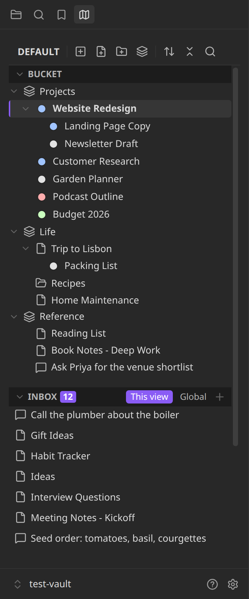
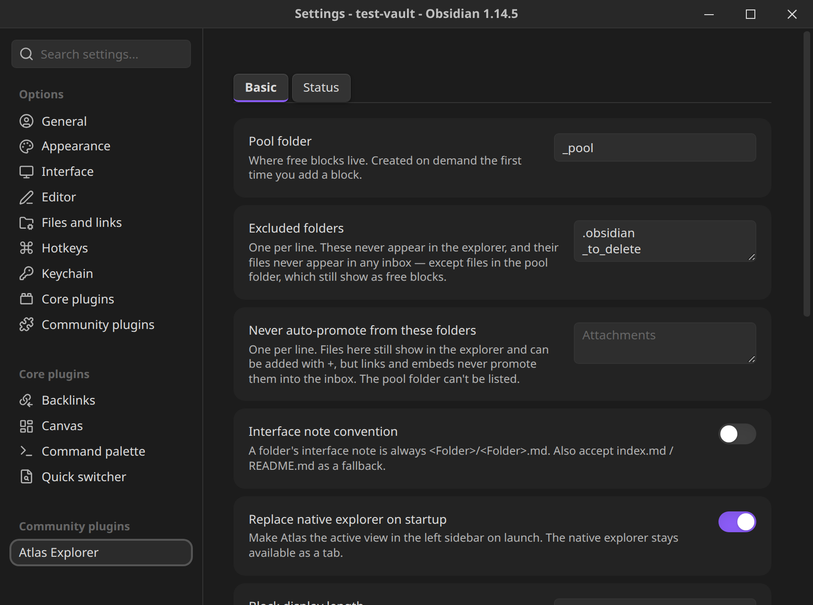

# Atlas Explorer

A replacement file explorer for Obsidian that shows every meaningful unit in your vault (blocks, files, folders) as one flat list, and lets you arrange those units into as many hierarchies as you like, without ever moving anything on disk.



## Install

Atlas Explorer is in Obsidian's community plugins. Open **Settings → Community plugins → Browse**, search for **Atlas Explorer**, install it and enable it. It needs Obsidian 1.13.1 or later. It is built to work on mobile too, but has not been tested on a device, and a few features are desktop only (noted below).

To build it yourself:

```bash
npm install
npm run build   # or `npm run dev` to watch
```

Then put `main.js`, `manifest.json` and `styles.css` in `.obsidian/plugins/atlas-explorer/` in your vault and enable **Atlas Explorer** under Settings → Community plugins. `npm test` runs the test suite and `npm run lint` the linter.

## Why

Folder paths in Obsidian do two jobs at once: they say what a thing *is* (stable) and what status it *has* (changes constantly). Every status change means a move, and every move breaks relative links and anything wired to that path. The fix is to stop using the folder hierarchy as an address book. Atlas separates the two jobs: the folder hierarchy on disk stays fixed, and you arrange things into any number of named **views**: drawings over the vault, not addresses for it. Rearranging becomes editing a drawing; nothing underneath moves.

## The model

### Three kinds of unit

A **unit** is anything that (a) has an address you can link to, and (b) means the same thing when taken out of its surroundings.

| Kind | Example | Address |
|---|---|---|
| **Block** | one paragraph, one bullet, one heading | `[[file#^id]]`, `[[file#Heading]]`, or a pool file (below) |
| **File** | a note, a document | `[[name]]` |
| **Module** (a folder) | a system: an agent, a codebase, a course | its interface note (below) |

### Capture at the largest self-contained level; promote on link

You capture a thing at the largest level where it's self-contained. A chat transcript is a file. An agent system is a folder. Anything *inside* a unit is internals, and internals are not units until something outside links to them, at which point they're **promoted** into a unit in their own right. This applies at every level: a module is a unit at capture; a file inside it stays internals until something outside the module links to it; a block inside that file stays internals until something links to *it*.

So `Bets/steps/step-3.md` isn't a unit today. The day something outside `Bets/` links to it, it is. You can also promote by hand, and by default links alone no longer put anything in your inbox: turn on **Auto-promote linked items** in Settings to have them appear there. You can also keep chosen folders out of auto-promotion.

### Free blocks

A thought too small to deserve a filename still needs to exist. These are **free blocks**: markdown files in a **pool folder** (default `_pool/`) whose filenames are auto-generated IDs you never type or see. The explorer shows a free block by its `title` frontmatter or its first line, never by its ID. Under the hood it's a file; to you it's a block. Rename one to a real name and it graduates to the vault root.

### Modules

Every folder is a unit: a **module** whose **interface** is a note saying what the folder is and what it's responsible for, with everything else inside as internals.

- The interface note is `<Folder>/<Folder>.md` by default (optionally also `index.md` / `README.md`). A module without one is still a unit.
- Clicking a module's name opens its interface note. Clicking its icon, or pressing and holding the row for 500 ms, opens a **Module contents** view of its internals, where you can hide items, promote them to the inbox, or drag them out onto the inbox or view.
- Atlas never rearranges a module's insides on disk, with one deliberate, confirmable exception: dragging a file or block directly onto a module's **icon** moves it in. A file that is already placed in a view stays placed where it is (in every view that holds it) after the move; a placed block that is no longer a unit after the move is removed from the views.

### Views, bucket, inbox

- A **view** is one arrangement of units into a hierarchy. There can be many; the same unit can sit in many at once; no view is "the real one".
- Inside a view, the **bucket** is the arranged tree, and **Folders** are its branches: labels, not folders on disk (not to be confused with modules, which are real folders).
- A view's **inbox** is every unit not placed in that view; the **global inbox** is every unit placed in no view at all. You can add any file or sub-folder to the inbox with **+**, and dismiss rows you don't want to see.
- Any block, file or module can be the parent of any other bucket item, like a Folder can: drag one onto another's row to nest it.

## What you can do

- **Arrange without moving anything.** Drag to place, nest and reorder; multi-select with shift and cmd/ctrl-click; duplicate an item to organize its copy independently; scroll one panel with a sticky Bucket and Inbox. → [Using the explorer](docs/using-the-explorer.md)
- **Create in place.** Right-click a bucket row for **Add under…** (a new block, file, module or Folder nested under it), **Replace with…** (swap a Folder for a new block, file or module), **Swap with…** and **Swap for Atlas folder** (point a spot at something else, or turn it into a Folder, keeping its children, status and data source), and **Create Module** (turn a root-level note into a module). → [Using the explorer](docs/using-the-explorer.md#creating-replacing-and-swapping)
- **Open in a new tab.** Middle-click any bucket or inbox row, or use **Open in new tab** on its menu.
- **Mark things with statuses.** Status sets with colors, inheritance down a tree, hide and truncate by status, click a dot to change one. → [Statuses](docs/statuses.md)
- **Sort without losing your order.** Manual, A-Z, Modified, Time added or Status, with Reverse, on any item or the Bucket root. → [Sorting and reordering](docs/sorting.md)
- **Fill a Folder from somewhere else.** Data sources read rows from a JSON API, a folder (inside or outside the vault, with YAML filters), a CSV file or a Markdown table, on any bucket item. → [Data sources](docs/data-sources.md)
- **Link to anything.** Typing `[[` suggests files, modules and free blocks (found by content), and free-block links display as their text with a hover preview.
- **Let an agent in.** An optional, localhost-only MCP server lets an agent on your machine read and arrange your views and statuses. Desktop only. → [MCP server](docs/mcp-server.md)

## Settings

Under **Settings → Atlas Explorer**, with two tabs, **Basic** and **Status**. Every setting is described on [Settings and commands](docs/settings.md).



| Basic setting | Default |
|---|---|
| Pool folder | `_pool` |
| Excluded folders | dot-folders, the pool folder, `_to_delete` |
| Never auto-promote from these folders | none |
| Auto-promote linked items | off |
| Interface note convention | `<Folder>/<Folder>.md` only |
| Replace native explorer on startup | on |
| Block display length | 80 |
| Confirm before adding a unit to a module | on |
| Highlight the open note | on |
| Default view on launch | Default |
| MCP server (desktop only) | off, port `27202` |

The **Status** tab holds status sets, the color palette, Glow, Retain icons and Retained icon color.

## Commands

| Command | What it does |
|---|---|
| `Atlas Explorer: Add block` | Creates a new free block and opens it, cursor ready, with no filename prompt. |
| `Atlas Explorer: Open explorer` | Opens or focuses the Atlas view in the left sidebar. |
| `Atlas Explorer: Switch view…` | Fuzzy-picks another view and makes it active. |
| `Atlas Explorer: Place active file in view…` | Picks a view, then a folder within it, and places the active file there. |
| `Atlas Explorer: Reveal active file in Atlas` | Opens the explorer and says so if the active file isn't placed anywhere. |
| `Atlas Explorer: New view` | Prompts for a name and creates a new, empty view. |
| `Atlas Explorer: Rebuild index` | Forces a full re-scan of every unit in the vault. |
| `Atlas Explorer: Copy render log` | Copies Atlas's log of the last 500 list rebuilds to the clipboard as JSON (what triggered each, when, how long, whether the output changed). It holds no note text or paths and is kept in the plugin folder, not `data.json`. For bug reports. |

## What Atlas touches on disk

Arranging, sorting, nesting, duplicating, swapping and removing from a view never touch disk, and Atlas never edits the content of your notes. The only things that create or move files are the ones you ask for by name: Add block / file / module, **Add under…**, **Replace with…**, **Create Module**, **Create interface note**, a confirmable single-item drop onto a module's icon, and a free block graduating when you rename it. Data sources only ever read. Details on [Concepts](docs/concepts.md#when-atlas-touches-your-files).

**Placed rows stay while the file exists.** A file or folder you placed in a view keeps rendering as a normal row for as long as it exists in the vault, even if it is no longer an Atlas unit (for example a note you moved into a module folder that nothing links to). Only a target that is really gone shows as a greyed "(missing)" row with a Remove button, and it returns to normal if the path reappears. Atlas does not promote, write or move anything to make this happen.

## Documentation

- The pages in [`docs/`](docs/index.md): [Concepts](docs/concepts.md), [Using the explorer](docs/using-the-explorer.md), [Statuses](docs/statuses.md), [Sorting and reordering](docs/sorting.md), [Data sources](docs/data-sources.md), [Settings and commands](docs/settings.md) and [MCP server](docs/mcp-server.md).
- [`docs/decisions.md`](docs/decisions.md): the judgement calls made during the build, the alternatives considered, and why.
- [`TASKS.md`](TASKS.md): the original build task list, with what was verified live and what was only code-reviewed.

## License

MIT, see [LICENSE](LICENSE).
