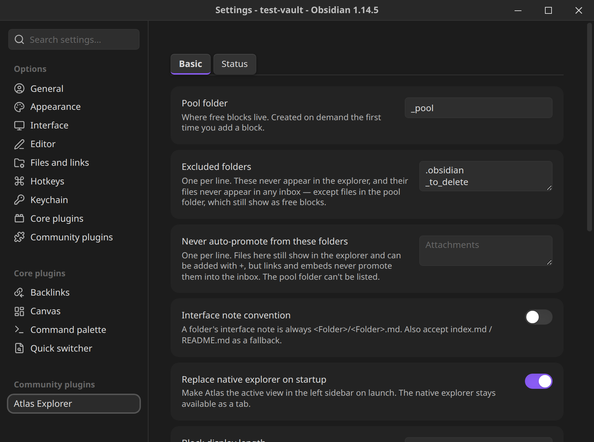

[Atlas Explorer](index.md) › Settings and commands

# Settings and commands

Open **Settings → Atlas Explorer**. The panel has two tabs, **Basic** and **Status**. The screenshot shows the top of the Basic tab.

## Basic

| Setting | Default | What it does |
|---|---|---|
| Pool folder | `_pool` | Where [free blocks](concepts.md#free-blocks) live. Created on demand the first time you add a block. Changing it re-indexes and warns about blocks left behind in the old folder. |
| Excluded folders | dot-folders, the pool folder, `_to_delete` (worked out on first load) | One per line. These never appear in the explorer, and their files never appear in any inbox, except files in the pool folder, which still show as free blocks. |
| Never auto-promote from these folders | empty | One per line. Files here still show in the explorer and can be added with **+**, but links and embeds never promote them into the inbox. Promotion by hand, units and placement are unchanged. The pool folder can't be listed. Only matters while **Auto-promote linked items** is on. |
| Auto-promote linked items | off | When off, the inbox holds only what you add with **+** or promote by hand (plus your modules and loose notes); a file, folder or block that another note links to or embeds no longer appears there on its own. Turn it on and linked items appear in the inbox at once, off and they leave again, with no reload. Items you already placed in a view stay where they are either way, and links in your notes resolve as usual. Items a [Folder data source](data-sources.md#folder) manages count as linked too: other views' inboxes leave them out while it's off. Anything the switch keeps out of the inbox is still offered by **+**, unless you dismissed it. |
| Interface note convention | `<Folder>/<Folder>.md` | Toggle to also accept `index.md` / `README.md` as a folder's interface note. |
| Replace native explorer on startup | on | Makes Atlas the active view in the left sidebar on launch. The native explorer stays available as a tab. |
| Block display length | 80 | How many characters of a free block's first line to show in the explorer. |
| Confirm before adding a unit to a module | on | Ask before a drag onto a module's icon physically files something into it. Off skips the confirmation, not the move. |
| Highlight the open note | on | Gives the row(s) for the note open in the editor a visible highlight. |
| Default view on launch | Default | Which view Atlas opens to when the vault loads. |

### MCP server

Off by default, and desktop only. See [MCP server](mcp-server.md) for what it offers. In settings: **Enable MCP server**, **Port** (default `27202`, per device), and **Token** (with a **Regenerate** button). On mobile this section just says the server runs on desktop only.

## Status

Status sets, the shared color palette, and the Glow, Retain icons and Retained icon color options. See [Statuses](statuses.md).

## Tephra

Desktop only. [Tephra](https://github.com/danrfletcher/Tephra) is a local program that indexes any number of folders ("sources") into one link graph. This tab has one switch, **Turn on Tephra multi-data source vault**, off by default. With it off Atlas does nothing Tephra-related: no connection, no background check, no change to your links.

With it on, Atlas asks Tephra for its source list when you turn the switch on, and again every 10 seconds, and shows the state:

- **Tephra isn't running.** The switch stays on. The tab shows the install command (`tephractl daemon install`) and the repo link. Atlas never runs it for you. When the daemon starts, the next check turns the tab to online without reopening settings.
- **Connected.** One row per source: name, folder path and status (online, missing or offline). The vault itself (`notes`) has no options. Every other source has **Show in Obsidian search & graph**, on by default. Turning it off adds `Sources/<name>/` to Obsidian's **Files & links → Excluded files**; turning it on removes exactly that entry and leaves your own entries alone.

### The `Sources/` folder

With the switch on and Tephra running, Atlas keeps one folder link per top-level Tephra source in your vault: `Sources/<name>` is a real symbolic link to the source's folder on disk. Obsidian indexes those files like any others, so they show in search, the Quick Switcher, the graph and the file explorer. Atlas follows Tephra's list: a source added or removed with `tephractl` gains or loses its link at the next check (every 10 seconds, or when the Obsidian window gets focus). A source whose folder is inside another source's folder gets no link, and neither does your vault (`notes`). If a source's folder is moved in Tephra, its link is replaced to point at the new path; if you delete a link by hand, it comes back at the next check.

- **If `Sources` is already yours, the switch refuses to turn on.** Atlas only takes over `Sources/` when every entry in it is a link Atlas made earlier (an empty `Sources/` Atlas left behind counts). If `Sources` is a file, or a folder holding anything else, a notice names the path and the switch goes back to off. Nothing is moved, created or excluded. Rename or move your `Sources` and turn the switch on again. (`Sources.md` is fine; only the exact path `Sources` clashes.) If one source's name clashes with a real file or folder inside `Sources/`, only that one link is skipped, with a notice.
- **`.gitignore`.** Atlas adds the single line `Sources/` to the `.gitignore` at the vault root (creating the file if needed, and keeping your lines). Turning the switch off leaves that line in place.
- **Excluded files.** Source files are not excluded from search by default. Atlas adds, for each source, `Sources/<name>/.git/` and the entries from the source's root `.gitignore` (for example `target/`, `node_modules/`) to **Files & links → Excluded files**, and keeps them in step when that `.gitignore` changes. A plain path becomes a path entry and a glob becomes a `/regex/` entry. Lines starting with `!`, lines that aren't a valid pattern, and anything past 500 entries per source are skipped, and `.gitignore` files in subfolders are never read. Entries you added yourself are never touched.
- **Sources is not a module.** While the switch is on, Atlas ignores `Sources/` in the explorer: it isn't listed as a folder in the vault section, and links to or from files under it don't promote vault units. With the switch off, a `Sources` folder of your own is an ordinary folder again.
- **Deleting a source's files.** If Tephra reports a source as missing (its folder was deleted or its drive unplugged), its link stays and the files vanish from the vault; your views keep their rows, shown greyed as missing, and they return unchanged when the folder comes back. Deletes caused by Atlas itself (switch off, source removed) are not treated as you deleting those notes. A note you delete in Obsidian inside a linked source is an ordinary delete.

### Adding and removing a source

With the switch on and Tephra running, the vault's Inbox **+** button opens a small menu: **Add file…** (the same as always) and **Add source…**. **Add source…** opens your system's folder picker, then asks for a name (prefilled from the folder's name: `My Notes` becomes `my-notes`). The name turns red with the reason while it can't be used: it is empty, has a space, has `/`, `@`, `:` or `*`, has any character outside letters a-z, digits, `.`, `_` and `-` (so no unicode: `[[@name:…]]` links can't carry it), is 200 bytes or longer, matches a source Tephra already has (or your vault's own `notes`, in any capitalisation), or `Sources/<name>` already exists in the vault. Atlas also refuses a folder inside the vault, the vault itself, and anything under `Sources/`, before asking for a name. Confirming sends one request to Tephra. If Tephra refuses (for example the folder overlaps another source), its reason shows in the dialog and you can change the name and try again. If Tephra doesn't answer in time, Atlas does not send the request again: it reads Tephra's list and either shows the new source or says it couldn't confirm.

To remove a source, right-click its Inbox header (`[whoop]`) and choose **Remove**, then confirm. Tephra stops indexing it and Atlas removes the `Sources/<name>` link. Your files in the source's folder are never touched. The vault's own header has no Remove. A real folder or note of yours at `Sources/<name>`, or a link Atlas didn't make, is left alone and a notice says so. If Tephra isn't running, both actions say so and do nothing: Atlas never starts Tephra.

### Opening a file from a source

Clicking a file in a source's Inbox section, middle-clicking it, choosing **Open** or **Open in new tab**, or clicking a file in a source module's Module Contents opens the file at its `Sources/<name>/…` path, the same way a vault file opens. Atlas asks Obsidian whether it has a view for the file's extension (case does not matter: `.PDF` is `.pdf`): if it does, the file opens in a tab (a new tab for middle-click and **Open in new tab**); if it doesn't, Atlas hands it to Obsidian's open-in-default-app, which opens it in the Mac app for that type. Notes, canvases, PDFs, images, audio and video are Obsidian's own. Code files open in Obsidian when a plugin such as VS Code Workbench has registered the extension, and in the default app when none has. A file with no extension (`Makefile`, `LICENSE`) follows the same rule.

Word (`.doc`, `.docx`), PowerPoint (`.ppt`, `.pptx`), Excel (`.xls`, `.xlsx`) and Google Docs and Sheets (`.gdoc`, `.gsheet`) files always open in their own app, even if a plugin registers a text view for them, so they are never edited in Obsidian. A PDF opens only in Obsidian's read-only PDF view. Edits to a note are saved by Obsidian through the `Sources/<name>` link to the file in the source's folder; Atlas never writes to a file by opening it. A source's file that is missing does nothing when clicked, and a file Obsidian can't read (no permission on the folder) shows Obsidian's own error and an `[Atlas]` line in the developer console. With the switch off, files open exactly as before.

### Turning it off

Atlas reads Tephra's token from `$XDG_DATA_HOME/tephra/token`, else `~/.local/share/tephra/token`. It re-reads it once if Tephra answers 401, and never stores or logs it.

Advanced, no settings field: to point Atlas at a Tephra on another port (for example a second Tephra on a scratch port), add `"tephraUrl": "http://127.0.0.1:<port>"` to `settings` in the plugin's `data.json` and turn the switch off and on. Only `http://` on `127.0.0.1`, `localhost` or `[::1]` with an explicit port is accepted, because the token is sent to that address; anything else is ignored with a console warning and the default `127.0.0.1:4812` is used. Leave it out for normal use.

**Turn the switch off before uninstalling Atlas.** Atlas's Tephra changes are only undone by the switch. Turning it off removes every `Sources/<name>` link (the link only: your source folders and their files are never touched), removes `Sources/` if it is then empty, removes the Excluded files entries Atlas added, saves the setting and stops checking. The `Sources/` line in `.gitignore` stays. It never unregisters a source in Tephra. Disabling or uninstalling the plugin, or quitting Obsidian, runs no clean-up and changes nothing: the links, the `.gitignore` line and the Excluded files entries all stay.

On mobile the switch is disabled and Atlas behaves as if it were off.

## Commands

Open the command palette and search for "Atlas Explorer".

| Command | What it does |
|---|---|
| `Atlas Explorer: Add block` | Creates a new free block in the pool folder and opens it with the cursor ready to type, with no filename prompt. |
| `Atlas Explorer: Open explorer` | Opens or focuses the Atlas view in the left sidebar. |
| `Atlas Explorer: Switch view…` | Fuzzy-picks another view and makes it active. |
| `Atlas Explorer: Place active file in view…` | Fuzzy-picks a view, then a folder (or the bucket root) within it, and places the active file there: the keyboard and mobile equivalent of dragging it in. |
| `Atlas Explorer: Reveal active file in Atlas` | Opens the explorer and, if the active file isn't placed anywhere, says so. |
| `Atlas Explorer: New view` | Prompts for a name and creates a new, empty view. |
| `Atlas Explorer: Rebuild index` | Forces a full re-scan of every unit in the vault, and logs timings to the console. |
| `Atlas Explorer: Copy render log` | Copies the render log to the clipboard as JSON and shows a notice with the entry count (`[]` if it is empty). Each entry has only `kind` (what triggered the rebuild), `at` (epoch ms), `durationMs` and `changed`: no note text, labels or paths. The log keeps the last 500 rebuilds in `render-log.json` in the plugin folder, is always on, and has no setting. |

Everything else is on the explorer's right-click menus; see [Using the explorer](using-the-explorer.md). There are no default hotkeys.

## Where Atlas keeps its data

In the plugin's `data.json`: your settings, views and their trees, manual promotions, dismissed and added items, status sets and the data-source configuration and cached rows. Two things are deliberately kept on the device only and never synced: **API headers** and **outside-the-vault folder paths** (both can hold things that are specific to one machine or secret), and the MCP port and token.

The render log is separate: `render-log.json` in the plugin folder (see **Copy render log** above), so log writes never rewrite `data.json`.
